# Entrega práctica 2 — Silver, Gold y orquestación

- **Nombre:** Francisco Benitez
- **student_id:** francisco_benitez
- **Escala:** small

## DAG del Job

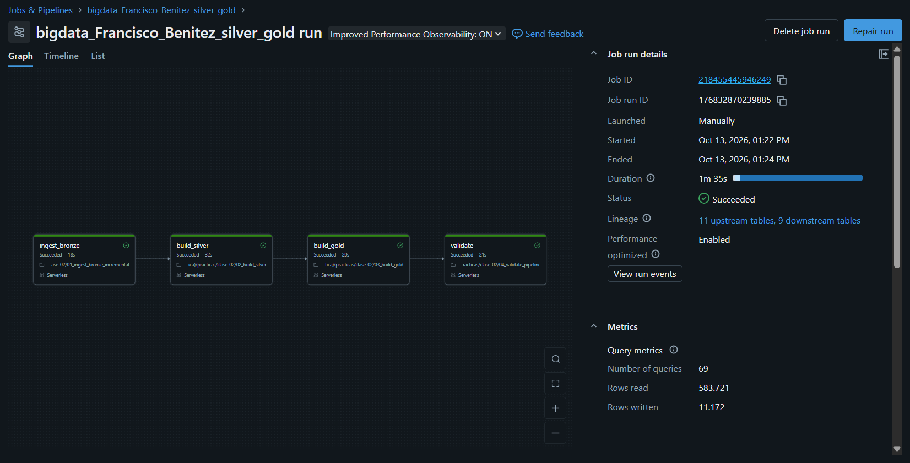

Las cuatro tareas (`ingest_bronze → build_silver → build_gold → validate`) corrieron en orden y terminaron en `Succeeded`.

## Job

- **Nombre / Job ID:** `218455445946249` (`bigdata_Francisco_Benitez_silver_gold`)
- **URL:** https://dbc-9ee32bcb-db3a.cloud.databricks.com/jobs/218455445946249?o=7474644858809628

## Resultados de la primera y segunda ejecución

Se corrió el Job dos veces con `expected_batch_id=batch_002`, sin generar ningún archivo nuevo entre una corrida y otra, para comprobar idempotencia:

```sql
SELECT * FROM pipeline_run_audit WHERE expected_batch_id = 'batch_002'
```

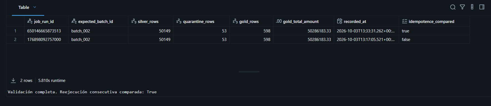

- **Primera ejecución** (`job_run_id` 176898092757000, 2026-10-03 13:17): `idempotence_compared = false` (no hay corrida previa con qué comparar). `silver_rows=50149`, `quarantine_rows=53`, `gold_rows=598`, `gold_total_amount=50286183.33`.
- **Segunda ejecución** (`job_run_id` 650146665873513, 2026-10-03 13:33): `idempotence_compared = true`, con exactamente los mismos valores (`silver_rows=50149`, `quarantine_rows=53`, `gold_rows=598`, `gold_total_amount=50286183.33`).

Los números no cambian entre ambas corridas, lo que confirma que el pipeline es idempotente.

## Cantidades aceptadas y rechazadas para `batch_002`

- Aceptadas (`silver_transactions`): 200
- Rechazadas (`silver_transactions_quarantine`): 2

## Por qué `COPY INTO` y `MERGE` resuelven problemas diferentes

`COPY INTO` resuelve idempotencia a nivel de **archivo**: evita volver a cargar un archivo físico que ya fue procesado, comparando contra su propio historial interno. `MERGE` resuelve idempotencia a nivel de **fila**: decide, para cada registro individual identificado por `transaction_id`, si corresponde insertarlo como nuevo o actualizar uno existente según cuál es más reciente (`updated_at`). Uno evita duplicar ingestas completas; el otro evita duplicar o perder registros dentro de esas ingestas.

## Visualizaciones

### Consigna 1 — Evolución temporal

**Pregunta:** ¿Qué día tuvo el mayor monto vendido y ese día también fue el de mayor cantidad de transacciones?

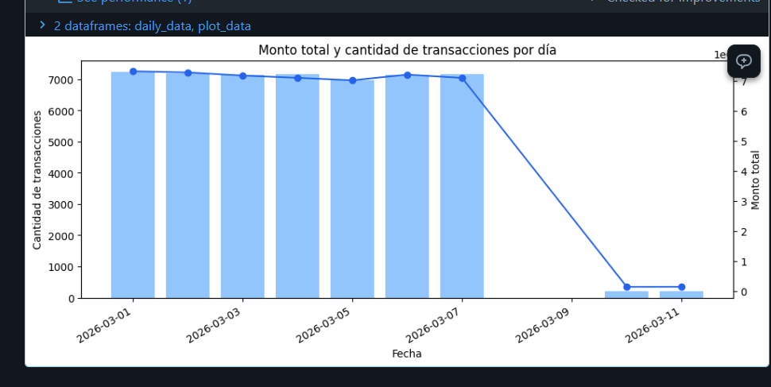

El 2026-03-01 tuvo el mayor monto total (7310840.77) y también la mayor cantidad de transacciones (7236), así que ambos máximos coinciden en el mismo día. Eso tiene sentido: al ser el día con más volumen de transacciones, es también el que más monto acumula, sin que eso implique un ticket promedio distinto al resto.

### Consigna 2 — Canal y fraude

**Pregunta:** ¿Qué canal de pago presenta la mayor tasa de fraude? ¿La conclusión se sostiene al considerar el número de transacciones de cada canal?

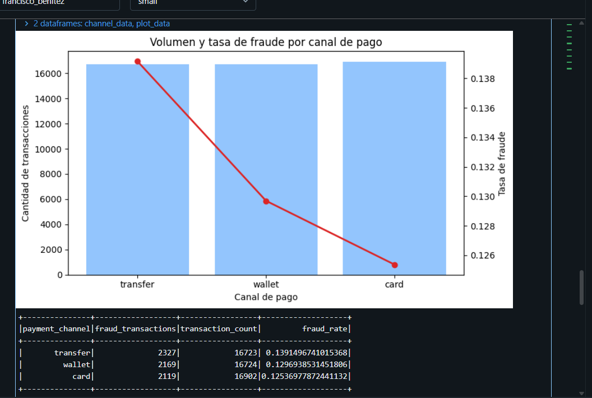

`transfer` tiene la tasa global de fraude más alta (13.9%), seguido de `wallet` (13.0%) y `card` (12.5%). La conclusión se sostiene al considerar el volumen: los tres canales tienen una cantidad de transacciones muy similar (~16700-16900), así que la diferencia en tasa de fraude no se explica por un canal con pocos datos distorsionando el resultado — es una diferencia real entre canales con volúmenes comparables.

### Consigna 3 — Concentración geográfica y de producto

**Pregunta:** ¿Qué combinación de país y categoría genera el mayor monto? ¿Existe una categoría dominante en todos los países o cambia según el mercado?

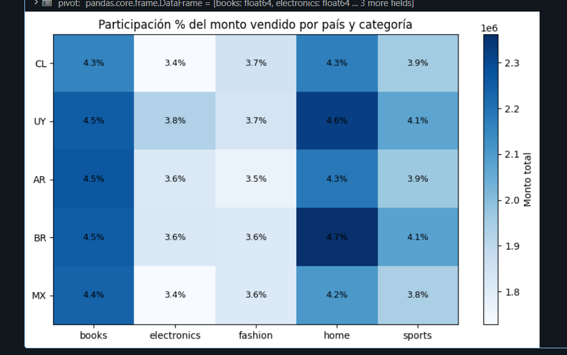

La combinación líder es Brasil (`BR`) y `home`, con 4.7% del monto total — pero está muy cerca de otras combinaciones (UY/home 4.6%, AR/books y BR/books 4.5%, UY/books 4.5%), así que no hay un outlier dominante, es una distribución bastante pareja entre los top combos. No hay una categoría que domine igual en todos los países: en `UY` y `BR` gana `home`, mientras que en `AR` y `MX` gana `books` (en `CL` quedan empatados). Lo que sí se repite en los 5 países es que `books` y `home` son siempre las dos categorías más fuertes, y `fashion`/`electronics` quedan consistentemente últimas. Se usó un mapa de calor porque permite comparar simultáneamente dos dimensiones (país y categoría) de un vistazo.

### Consigna 4 — Calidad del pipeline

**Pregunta:** ¿Qué proporción de cada lote fue aceptada y rechazada? ¿El lote nuevo presenta una calidad diferente del lote inicial?

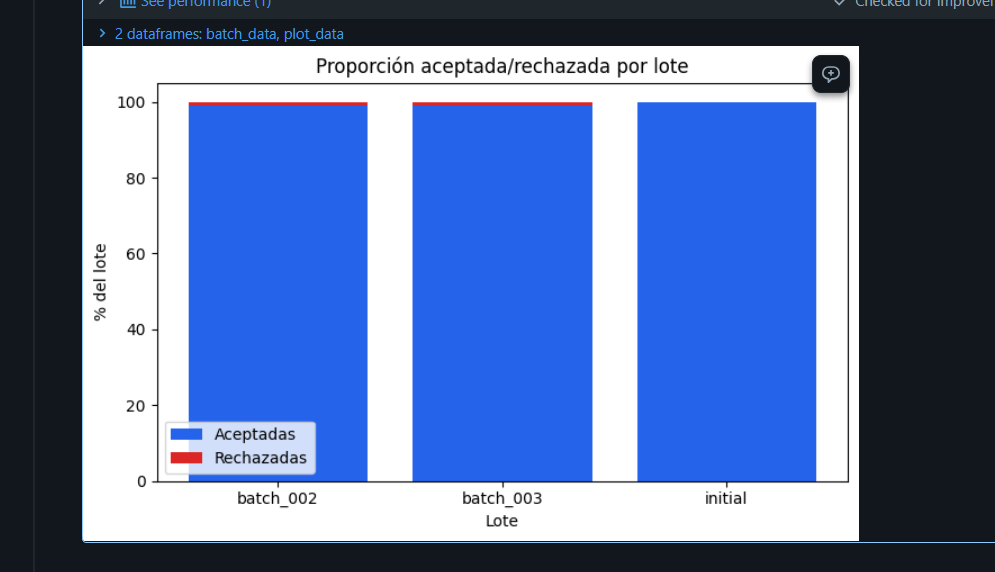

Cada lote tiene aceptación cercana al 100% (`initial` ≈99.90%, `batch_002`/`batch_003` ≈99.01%). Sí, el lote nuevo presenta calidad distinta: rechaza proporcionalmente casi 10 veces más que `initial` (≈0.99% contra ≈0.10%), aunque en cantidad absoluta tenga muchos menos rechazos — se usó una barra apilada al 100% para que el tamaño tan distinto de los lotes no distorsione la comparación visual.

## Preguntas de análisis y comprensión

### Análisis de las tablas

**1.** ¿Cuántas filas físicas recibió cada lote en `bronze_transactions_incremental`?

```sql
SELECT source_batch_id, count(*) AS filas
FROM bronze_transactions_incremental
GROUP BY source_batch_id
```

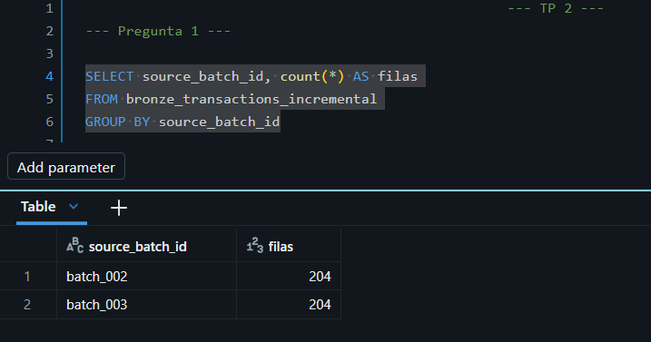

Resultado: `batch_002` → 204 filas, `batch_003` → 204 filas.

**2.** Para cada lote, ¿cuántas transacciones fueron aceptadas y cuántas quedaron en `silver_transactions_quarantine`? Reconciliá con `gold_batch_summary`.

```sql
SELECT source_batch_id, count(*) AS accepted_transactions
FROM silver_transactions
GROUP BY source_batch_id;

SELECT source_batch_id, count(*) AS rejected_transactions
FROM silver_transactions_quarantine
GROUP BY source_batch_id;
```

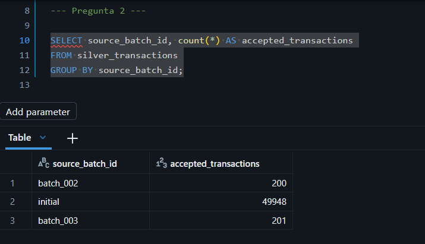
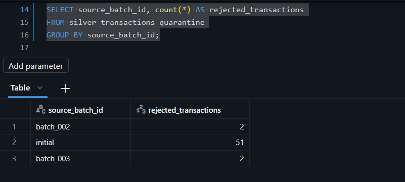

Resultado: aceptadas → `batch_002` 200, `initial` 49948, `batch_003` 201. Rechazadas → `batch_002` 2, `initial` 51, `batch_003` 2. Al consultar `SELECT * FROM gold_batch_summary` esos mismos números aparecen ya calculados por lote, confirmando que Gold reconcilia perfecto con lo que da sumar a mano desde Silver.

**3.** ¿Qué motivos de rechazo aparecen en la cuarentena y cuántos registros tiene cada uno por lote?

```sql
SELECT source_batch_id, quality_reason, count(*) AS cantidad
FROM silver_transactions_quarantine
GROUP BY source_batch_id, quality_reason
```

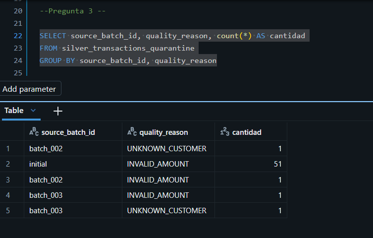

Resultado: `batch_002` → 1 `UNKNOWN_CUSTOMER` y 1 `INVALID_AMOUNT`; `batch_003` → 1 `INVALID_AMOUNT` y 1 `UNKNOWN_CUSTOMER`; `initial` → 51 `INVALID_AMOUNT` (el resto de los 51 rechazos repartidos a mayor escala). Esto coincide con lo que a propósito inyecta el generador en cada batch nuevo: una fila con `amount: "N/A"` (dispara `INVALID_AMOUNT`) y una fila con un `customer_id` inexistente, fuera de rango (dispara `UNKNOWN_CUSTOMER`).

**4.** Seguí la transacción `42` desde `bronze_transactions_all` hasta `silver_transactions`.

```sql
SELECT transaction_id FROM bronze_transactions_all WHERE transaction_id = 42

SELECT transaction_id FROM silver_transactions WHERE transaction_id = 42
```

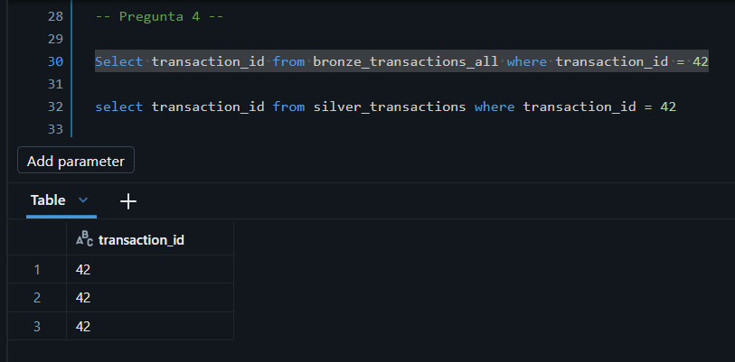
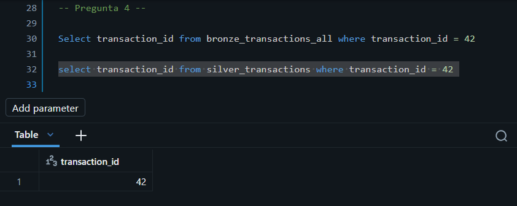

En Bronze hay 3 versiones con `transaction_id = 42`; en Silver queda una sola, la de `updated_at` más reciente (la deduplicación por `_record_key` + `row_number` se encarga de eso).

**5.** Comprobá que `silver_transactions` tiene una sola fila por `transaction_id`.

```sql
SELECT transaction_id, count(*)
FROM silver_transactions
GROUP BY transaction_id
HAVING count(*) > 1
```

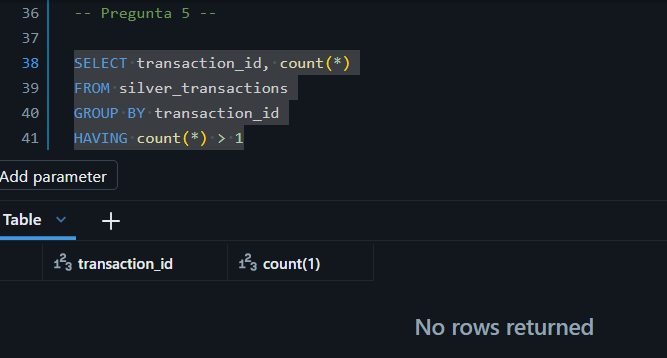

El resultado no devuelve filas (`No rows returned`), lo que confirma que no hay `transaction_id` duplicados. Si la deduplicación hubiera fallado, acá aparecería al menos una fila con `count(*) > 1`.

**6.** Tasa de rechazo de cada lote (`rechazadas / (aceptadas + rechazadas)`).

```sql
SELECT source_batch_id, (rejected_transactions / (accepted_transactions + rejected_transactions))
FROM gold_batch_summary
```

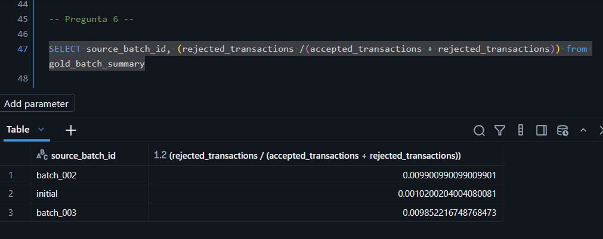

Resultado: `batch_002` ≈ 0.99%, `initial` ≈ 0.10%, `batch_003` ≈ 0.99%. No alcanza con comparar las cantidades absolutas: `initial` tiene 51 rechazos pero sobre ~50.000 filas, mientras que `batch_002`/`batch_003` tienen solo 2 rechazos cada uno pero sobre apenas ~200 filas. En términos absolutos `initial` rechaza más, pero en proporción rechaza casi 10 veces menos — la tasa es la métrica correcta para comparar lotes de tamaños distintos.

**7.** ¿Qué día presenta el mayor monto total y cuál la mayor cantidad de transacciones?

\`\`\`sql
SELECT sale_date, SUM(transaction_count) AS transaction_count, SUM(total_amount) AS total_amount
FROM gold_daily_sales
GROUP BY sale_date
ORDER BY total_amount DESC
\`\`\`

El día con mayor monto total y mayor cantidad de transacciones es el mismo: 2026-03-01, con $7.310.840,77 y 7.236 transacciones. Ambos máximos coinciden. (`gold_daily_sales` tiene una fila por día, país, categoría y canal, así que hace falta agrupar por `sale_date` con `SUM` para obtener el total del día — una consulta sin `GROUP BY` solo muestra el máximo de una combinación puntual, no el total diario.)


**8.** ¿Qué canal de pago tiene la mayor tasa global de fraude?

```sql
SELECT payment_channel, SUM(fraud_transactions) / SUM(transaction_count)
FROM gold_daily_sales
GROUP BY payment_channel
```

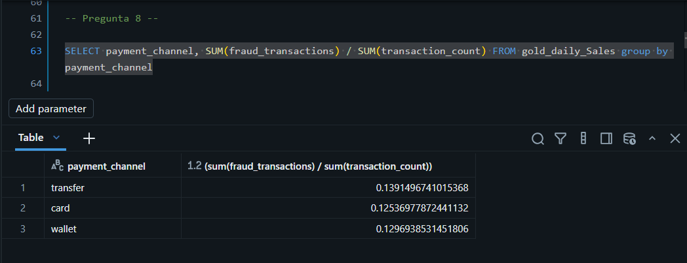

Resultado: `transfer` ≈ 13.9%, `wallet` ≈ 13.0%, `card` ≈ 12.5%. `transfer` tiene la mayor tasa global. No corresponde promediar directamente el `fraud_rate` de cada día porque esa tasa está atada a un volumen de transacciones distinto cada día; un día con pocas transacciones de un canal puede mostrar una tasa alta sin pesar realmente en el total. Sumar fraudes y transacciones primero, y dividir recién al final, pondera cada día según su volumen real.

**9.** ¿Qué combinación de país y categoría concentra el mayor monto vendido?

```sql
SELECT country, category, SUM(total_amount) AS monto_total
FROM gold_daily_sales
GROUP BY country, category
ORDER BY monto_total DESC
```

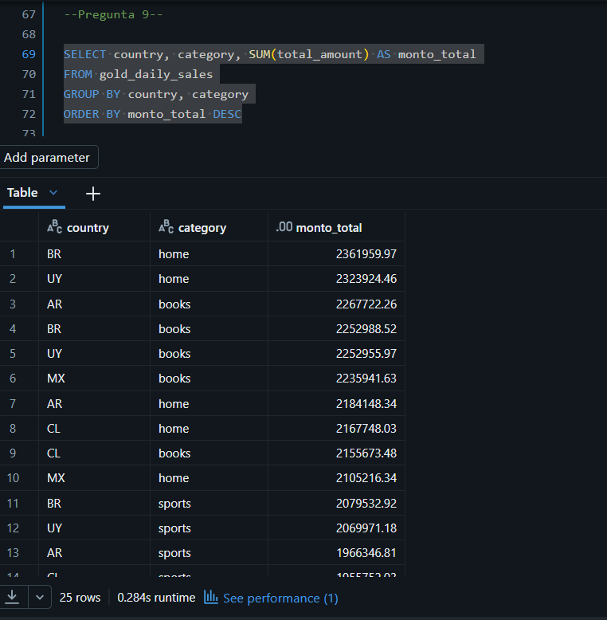

La combinación líder es Brasil (`BR`) y `home`, con 2361959.97. Dentro de cada país la categoría líder varía: en Uruguay (`UY`) es `home`, en Argentina (`AR`) es `books`, en Chile (`CL`) es `home`, en México (`MX`) es `books`.

**10.** Comparación de las filas de `pipeline_run_audit` correspondientes a la reejecución de `batch_002`/`batch_003`.

```sql
SELECT * FROM pipeline_run_audit
```

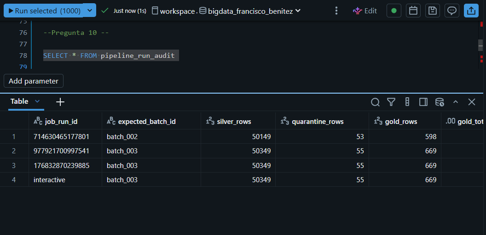

`pipeline_run_audit` tiene 4 filas: una para `batch_002` y tres para `batch_003` (dos corridas del Job más una ejecución interactiva). Las tres filas de `batch_003` tienen exactamente los mismos valores de `silver_rows` (50349), `quarantine_rows` (55) y `gold_rows` (669), lo que demuestra que reejecutar el mismo batch no cambia el resultado.

### Interpretación del código y del pipeline

**11.** ¿Qué problema resuelve `COPY INTO` en `01_ingest_bronze_incremental.ipynb`?

`COPY INTO` evita cargar dos veces el mismo archivo físico llevando un registro interno de los archivos ya procesados, identificados por su ruta y metadata. Antes de cada corrida compara el contenido del directorio de la landing zone contra ese historial, y solo incorpora los archivos verdaderamente nuevos. Esto resuelve el problema de que, al reejecutar el pipeline (por ejemplo al agregar `batch_003`), no haga falta filtrar manualmente los archivos ya cargados para evitar duplicarlos.

**12.** ¿Por qué `bronze_transactions_all` usa `UNION ALL`?

Usa `UNION ALL` porque la capa Bronze busca conservar todos los datos que entran en crudo, permitiendo tener toda la data original. La capa Silver es la que se encarga de eliminar esos duplicados, además de otras tareas; esto permite, si se necesitara volver a los datos en crudo para realizar nuevas tareas, que no se hayan perdido para siempre.

**13.** ¿Por qué las transacciones `initial` reciben `source_batch_id='initial'` y usan `event_ts` como `updated_at`?

Las transacciones `initial` reciben `source_batch_id='initial'` por ser la carga histórica base, y usan `event_ts` como `updated_at` porque nunca tuvieron un campo real de actualización — es el mejor sustituto disponible para que el `MERGE` las pueda comparar contra correcciones futuras. Cuando llega una corrección (como la transacción 42 en `batch_002`) con un `updated_at` más reciente que el de la fila `initial`, se cumple `WHEN MATCHED AND s.updated_at > t.updated_at`, y la fila existente se sobrescribe. Por eso en Silver queda una sola versión de la transacción 42: la más actualizada.

**14.** ¿Qué ventaja ofrece `try_cast` frente a un `cast` convencional?

Un `CAST` convencional sobre `"N/A"` lanza un error y detiene toda la ejecución, afectando incluso a las filas válidas del mismo lote. `try_cast`, en cambio, devuelve `NULL` cuando la conversión falla, sin interrumpir el proceso. Esto permite que `add_quality_reason` detecte después esos `NULL` con un simple `.isNull()` y los clasifique como `INVALID_AMOUNT`, en vez de que todo el pipeline se caiga por un solo registro malo.

**15.** ¿Qué sucede si un registro viola más de una regla de calidad?

Si un registro viola más de una regla, solo queda registrado el motivo de la primera condición que se cumple, aunque las demás también sean ciertas. Por eso el orden importa: está pensado de mayor a menor gravedad (primero el `transaction_id`, sin el cual ni se puede identificar la fila; después campos secundarios como `amount`), para que el motivo mostrado sea siempre el problema más importante.

**16.** ¿Cómo se construye `_record_key` y cómo se usa junto con `row_number`?

`_record_key` se construye con `coalesce(transaction_id_typed, hash)`: usa el `transaction_id` convertido a número si es válido, y si no (porque el `try_cast` falló), genera un hash único a partir de todas las columnas de esa fila como identificador alternativo. Esa clave se usa luego con `row_number()` particionando por `_record_key` y ordenando por `updated_at` descendente, para numerar las distintas versiones de cada transacción dentro de su grupo. Así, quedándose con `_rn = 1`, se conserva solo la versión más reciente de cada transacción (o de cada fila con ID inválido, que al no tener duplicados queda sola en su propio grupo).

**17.** Interpretá las dos cláusulas principales del `MERGE` de `silver_transactions`.

El `MERGE` compara los datos nuevos (`s`) contra lo ya guardado (`t`) por `transaction_id`. Si ya existe esa transacción y la nueva es más reciente, actualiza la fila; si no existe todavía, la inserta como nueva.

**18.** ¿Por qué Gold se reconstruye completamente mientras Silver se actualiza con `MERGE`?

Gold se reconstruye completa porque sus tablas son agregados (sumas por día, por lote, etc.): si una sola fila de Silver cambia, no alcanza con actualizar "una fila" de Gold, hay que resumar todo el grupo al que pertenece, lo cual es más complejo de programar que un simple `MERGE`. Por eso es más simple y menos propenso a errores recalcular todo, aunque reprocese más de lo necesario. En Silver se usa `MERGE` porque ahí sí hay una correspondencia 1 a 1 entre fila nueva y fila existente, lo que lo hace eficiente pero más delicado de programar bien.

**19.** ¿Por qué `expected_batch_id` no participa en la detección del archivo nuevo?

`expected_batch_id` no participa en la detección del archivo nuevo porque esa detección ya ocurrió antes, en el notebook 01: `COPY INTO` decide qué es nuevo mirando directamente los archivos físicos de la carpeta, sin leer ese parámetro para nada. `expected_batch_id` recién entra en juego en el notebook 04, y ahí no detecta nada — es un dato que se pasa manualmente para que el notebook verifique si el resultado del pipeline (qué quedó en `transactions`, cuántos rechazos hubo, etc.) coincide con el batch que se esperaba.

**20.** Si `build_silver` falla, ¿qué ocurre con `build_gold` y `validate`?

Si `build_silver` falla, el Job se detiene ahí y no ejecuta `build_gold` ni `validate`, porque las tareas del DAG están encadenadas (`build_silver → build_gold → validate`) y cada una depende de que la anterior termine bien. Esto evita que `build_gold` reconstruya la tabla con datos incompletos o corruptos, y como Gold se recrea como una tabla aparte (con `CREATE OR REPLACE`), si no corre simplemente queda con los datos de la última ejecución exitosa — desactualizada, pero nunca a medio escribir. Así el DAG evita publicar o validar resultados que partirían de un Silver roto.
