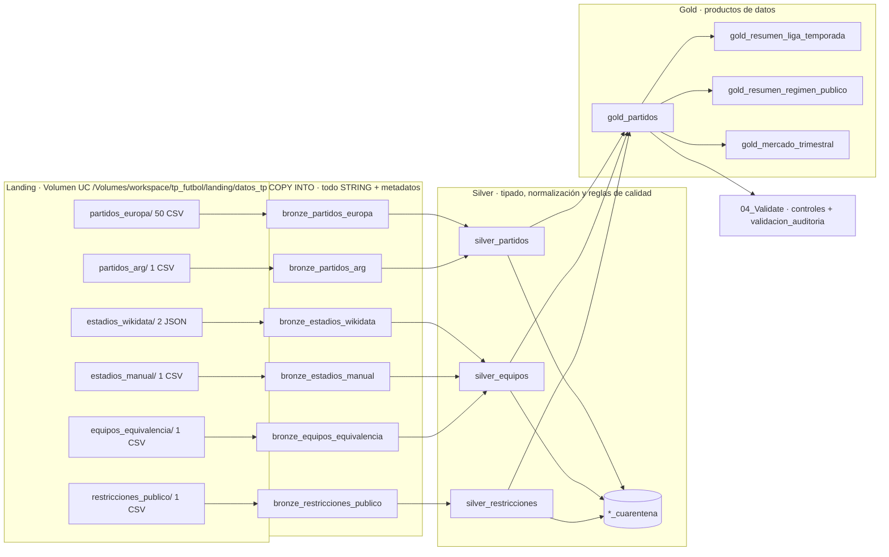
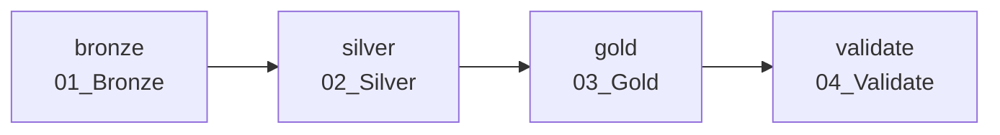
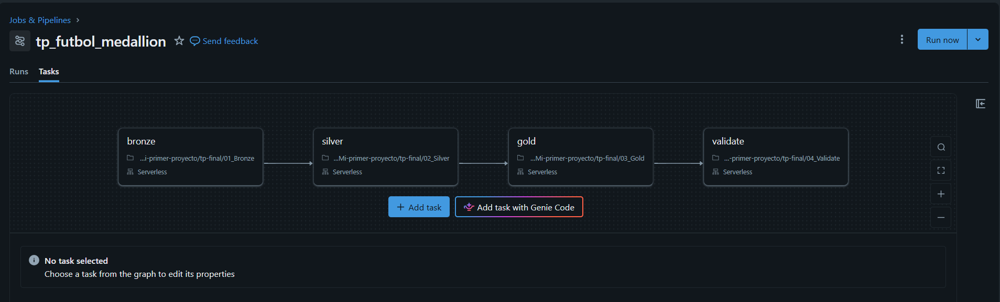
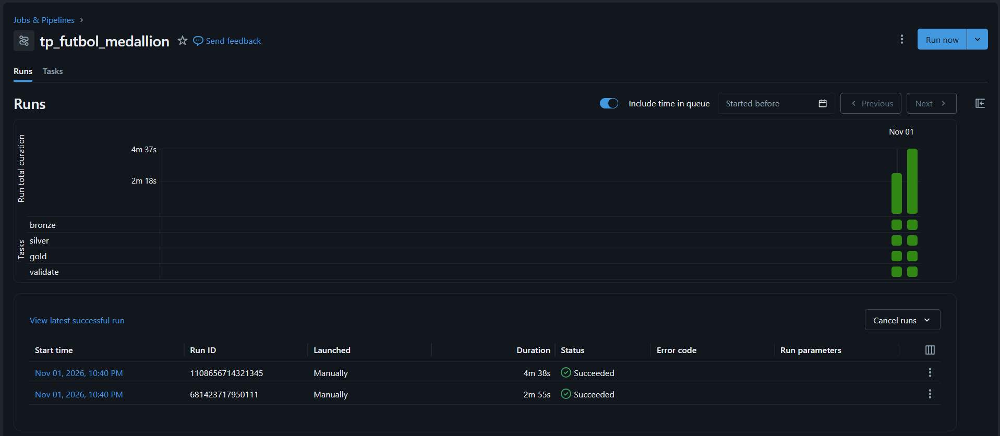
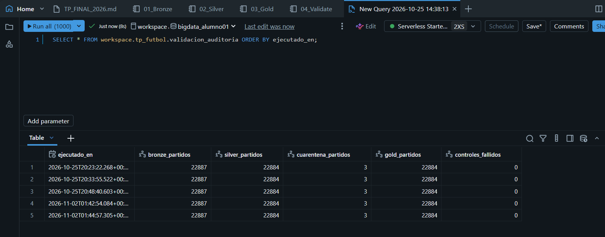
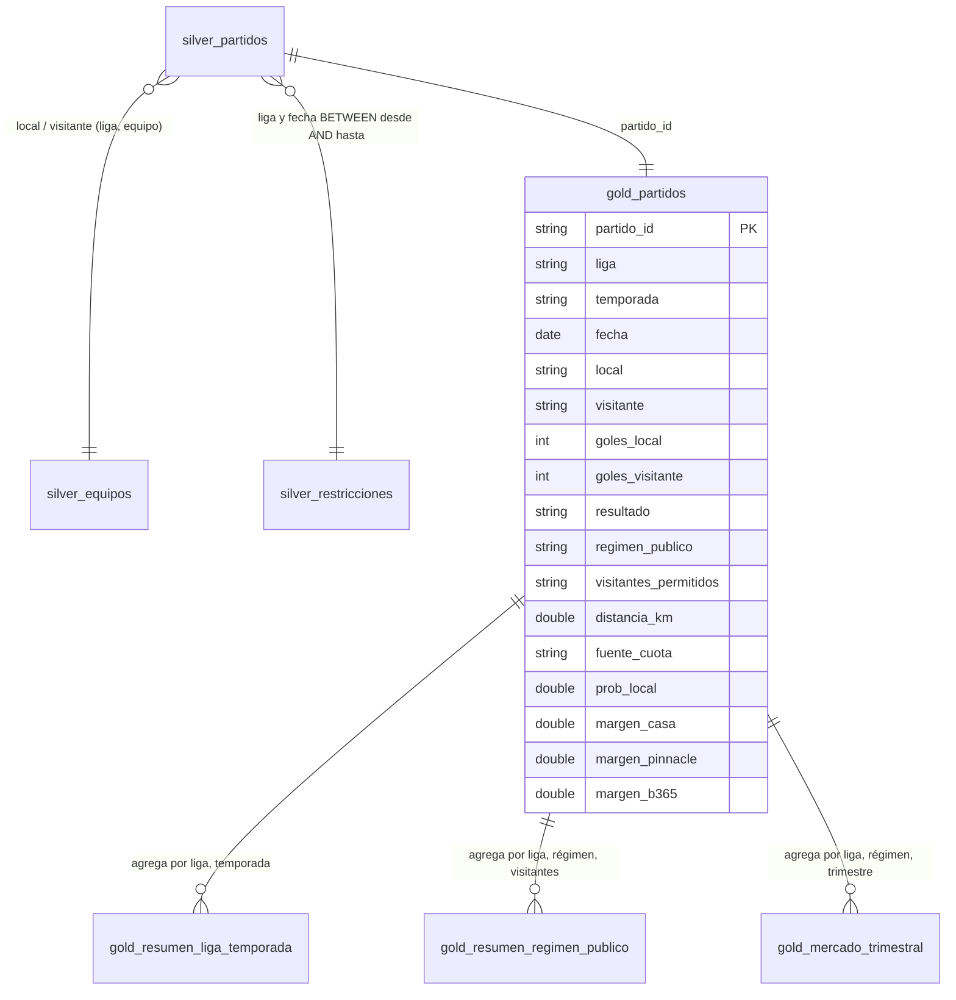

# Trabajo Práctico Final — Big Data y MLOps

**Estudiante:** Francisco Benitez
**Variante:** 2 — Ejecución · **Opción A — Arquitectura medallion en Databricks**
**Entorno:** Databricks Free Edition (serverless) · Unity Catalog `workspace.tp_futbol`

---

## 1. Objetivo

Construir una arquitectura **Bronze → Silver → Gold** sobre Databricks, orquestada como un **Lakeflow Job**, que integre resultados y cuotas de apuestas del fútbol argentino y de las cinco grandes ligas europeas con datos de estadios y con los períodos de restricción de público durante la pandemia de COVID-19.

El resultado son **productos de datos reutilizables** (Gold) que permiten explorar, entre otras, estas preguntas:

- ¿Cómo varía la **ventaja de local** entre ligas y a lo largo del tiempo?
- ¿Qué pasó con esa ventaja cuando se jugó **sin público**? ¿Ajustaron las **casas de apuestas** sus cuotas?
- ¿Influye la **distancia** que viaja el visitante?
- ¿Cuánto **margen** cobra cada casa de apuestas, y cómo cambia por liga y por año?

El trabajo no fija una única pregunta de investigación: Gold deja los datos listos para que cada pregunta se responda con una consulta.

---

## 2. Contenido de la carpeta

| Archivo | Descripción |
|---|---|
| `01_Bronze.ipynb` | Ingesta de las 6 fuentes desde el volumen `landing` con `COPY INTO` (tarea 1 del Job) |
| `02_Silver.ipynb` | Unificación, tipado, normalización y controles de calidad, con tablas de cuarentena (tarea 2) |
| `03_Gold.ipynb` | Tabla analítica de partidos y agregados (tarea 3) |
| `04_Validate.ipynb` | Controles automáticos de punta a punta y auditoría de cada corrida (tarea 4) |
| `05_visualizacion.sql` | Consultas y gráficos para verificar e interpretar el resultado final (fuera del Job) |
| `05_visualizacion_resultados.ipynb` | El mismo notebook exportado con sus salidas, como evidencia de los resultados de la sección 7 |
| `dag.png`, `job_run.png`, `auditoria.png` | Evidencia de ejecución: DAG del Job, corrida completa y auditoría |

---

## 3. Datos

### 3.1 Fuentes

| Fuente | Contenido | Formato | Archivos | Filas |
|---|---|---|---|---|
| [football-data.co.uk](https://www.football-data.co.uk) — ligas principales | Premier League (E0), LaLiga (SP1), Serie A (I1), Bundesliga (D1), Ligue 1 (F1), temporadas 2017/18 a 2026/27 (en curso) | CSV | 50 | 16.457 |
| football-data.co.uk — *extra leagues* | Liga Profesional Argentina, 2012 a 2026 | CSV | 1 | 6.430 |
| [Wikidata](https://query.wikidata.org) (SPARQL) | Clubes con estadio, coordenadas y capacidad; segunda consulta por nombre para los clubes faltantes | JSON | 2 | 1.095 |
| Manual (Wikipedia / StadiumDB) | Estadio de los 5 equipos sin datos en Wikidata | CSV | 1 | 5 |
| Manual | Equivalencia entre el nombre de cada equipo en football-data y su identificador de Wikidata | CSV | 1 | 203 |
| Manual (prensa y comunicados oficiales) | Períodos de público pleno, parcial o nulo por liga, con nivel de confianza y fuente por fila | CSV | 1 | 42 |
| **Total** | | | **56** | **24.232** |

El diccionario de columnas de football-data está en <https://www.football-data.co.uk/notes.txt>.

### 3.2 Esquema de entrada (columnas usadas)

| Concepto | Europa | Argentina |
|---|---|---|
| Liga / torneo | `Div` | `League` |
| Temporada | nombre del archivo (`E0_1718.csv`) | `Season` |
| Fecha, hora | `Date`, `Time` | `Date`, `Time` |
| Equipos | `HomeTeam`, `AwayTeam` | `Home`, `Away` |
| Goles y resultado | `FTHG`, `FTAG`, `FTR` | `HG`, `AG`, `Res` |
| Cuotas de cierre | `PSC*` (Pinnacle), `AvgC*` (promedio del mercado), `B365C*` (Bet365) | ídem |

`*` = `H` (local), `D` (empate), `A` (visitante). Las ligas europeas traen además estadísticas del partido y otros mercados (más goles, hándicap asiático), que no se usan.

### 3.3 Criterio de elección

- **Variedad**: tres formatos (CSV, JSON y CSV manual) y esquemas que cambian entre temporadas (de 62 a 132 columnas según el archivo).
- **Veracidad**: problemas de calidad reales y documentables (formatos de fecha distintos, cuotas imposibles, errores en Wikidata).
- **Relevancia**: las cuotas permiten comparar lo que el mercado esperaba con lo que pasó, y la pandemia ofrece un experimento natural sobre la ventaja de local.
- **Escala**: el volumen (unos 8 MB) entra en la Free Edition. El diseño es incremental: agregar ligas o temporadas consiste en dejar archivos nuevos en `landing`, sin cambiar el código.

---

## 4. Arquitectura



**Tecnologías:** Unity Catalog (catálogo, esquema y volumen), Delta Lake (todas las tablas), SQL sobre cómputo serverless, `COPY INTO` para la ingesta incremental y Lakeflow Jobs para la orquestación. El código se versiona en un Git folder de Databricks conectado a este repositorio.

---

## 5. Orquestación: Lakeflow Job

**Nombre:** `tp_futbol_medallion` · **Cómputo:** serverless · **Origen:** notebooks del Git folder (`tp-final/`)



Cada tarea depende de la anterior. Si una falla, las siguientes no se ejecutan y no se publican resultados incompletos. La tarea `validate` termina con error (`assert_true`) si algún control no se cumple.

**Evidencia:**

- DAG del Job: `dag.png`
- Corrida completa en verde: `job_run.png`. Dos ejecuciones manuales el 01/11/2026, ambas `Succeeded`: run `681423717950111` (2 min 55 s) y run `1108656714321345` (4 min 38 s).
- Auditoría con resultados idénticos en todas las corridas (idempotencia): `auditoria.png`. Las filas 4 y 5 corresponden a las dos ejecuciones del Job, y las filas 1 a 3 a ejecuciones manuales previas de `04_Validate`. Todas registran 22.887 partidos en Bronze, 22.884 en Silver, 3 en cuarentena, 22.884 en Gold y 0 controles fallidos.





---

## 6. Modelado y reglas de transformación

### 6.1 Bronze: conservar el dato recibido

- Una tabla Delta por carpeta de `landing`, cargada con `COPY INTO`.
- **Todas las columnas como texto** (`inferSchema = false`). Bronze no interpreta ni corrige.
- `mergeSchema = true` une las columnas de archivos con esquemas distintos.
- Metadatos de trazabilidad: `_source_file` (`_metadata.file_path`) e `_ingested_at`.
- **Idempotencia:** `COPY INTO` registra los archivos ya cargados. Una segunda ejecución inserta 0 filas, y un archivo nuevo se carga solo.
- **BOM:** 17 de los 51 CSV traen BOM UTF-8. Se verificó que el lector de Spark lo descarta: existe una sola columna `Div`, sin nulos.

### 6.2 Silver: datos confiables

Cada tabla Silver tiene una tabla `*_cuarentena` con las filas rechazadas y su `motivo_rechazo`. Las filas no se borran. Silver se recalcula completo desde Bronze (`CREATE OR REPLACE`), por lo que también es idempotente.

**`silver_partidos`**: una fila por partido, clave `partido_id = sha2(liga|fecha|local|visitante)`.

| Transformación | Detalle |
|---|---|
| Unificación | Europa y Argentina en un solo esquema con nombres en español |
| Temporada | Europa: desde el nombre de archivo (`1718` → `2017/18`). Argentina: `2012/2013` → `2012/13`, y los años calendario (`2014`) se mantienen |
| Fecha | Se lee según el largo del texto: `dd/MM/yy` u `dd/MM/yyyy` (ver hallazgos) |
| Tipos | Goles `INT`, cuotas `DOUBLE`, con `try_cast` para no cortar la ejecución |
| Texto | `trim` en torneo y equipos (`'Liga Profesional '` → `'Liga Profesional'`) |

| Regla de calidad (en orden) | Motivo |
|---|---|
| Fecha no convertible | `fecha_invalida` |
| Goles nulos o negativos | `goles_invalidos` |
| Resultado distinto del que surge de los goles | `resultado_inconsistente` |
| Alguna cuota ≤ 1 | `cuota_imposible` |
| Margen de Pinnacle fuera de [0; 0,25] | `margen_imposible_pinnacle` |
| Margen del promedio del mercado fuera de [0; 0,25] | `margen_imposible_promedio` |
| Mismo partido repetido (liga, fecha, local, visitante) | `duplicado` |

**`silver_equipos`**: una fila por equipo y liga (203).

- Separa el `Point(lon lat)` de Wikidata en latitud y longitud.
- Si un club tiene varios estadios, conserva el que tiene coordenadas y mayor capacidad.
- Une `bronze_equipos_equivalencia` con Wikidata (por `club_qid`) y, para los 5 restantes, con `bronze_estadios_manual`. Registra `fuente_coordenadas` y `precision_coordenadas` (estadio o ciudad).
- Reglas: `sin_coordenadas`, `coordenadas_fuera_de_region` (Argentina: latitud −56 a −21; Europa: latitud 27 a 61, que incluye Canarias) y `duplicado`.

**`silver_restricciones`**: 42 períodos, con fechas tipadas y valores normalizados.

- Reglas: `fecha_invalida`, `rango_invertido`, dominio de `regimen` / `visitantes` / `confianza`, y además `solapamiento` y `hueco` entre períodos de una misma liga (con `lag`). Así cada partido cae en exactamente un período.

### 6.3 Gold: productos de datos



| Tabla | Granularidad | Contenido principal |
|---|---|---|
| `gold_partidos` | 1 fila por partido (22.884) | Resultado, régimen de público vigente, distancia de viaje del visitante (Haversine entre estadios), cuotas, **probabilidades implícitas normalizadas** y margen por casa |
| `gold_resumen_liga_temporada` | liga × temporada | Porcentaje de victorias locales, empates y victorias visitantes; goles; probabilidad de local según el mercado; margen; distancia promedio |
| `gold_resumen_regimen_publico` | liga × régimen × visitantes | Las mismas métricas por régimen de público |
| `gold_mercado_trimestral` | liga × régimen × trimestre | Error del mercado sobre el local (probabilidad esperada − frecuencia real, en puntos) y márgenes por casa |

**Cálculos de Gold**

- **Cuota principal:** Pinnacle al cierre (la casa de referencia, con el menor margen). Si falta, se usa el promedio del mercado al cierre. La columna `fuente_cuota` indica cuál se usó.
- **Probabilidad implícita:** `1/cuota`. Las tres (local, empate, visitante) suman más de 1.
- **Margen de la casa:** `1/c_local + 1/c_empate + 1/c_visitante − 1`.
- **Probabilidad normalizada:** `(1/c) / Σ(1/c)`, que hace que las tres sumen exactamente 1.

### 6.4 Validación (`04_Validate`)

Nueve controles que deben cumplirse en cada corrida:

1. Las 6 tablas Bronze tienen datos.
2. Los partidos se conservan entre capas: Bronze = Silver + cuarentena.
3. `partido_id` no tiene duplicados.
4. La cuarentena de partidos es menor al 1% (alarma ante cambios de formato).
5. Todo equipo de un partido tiene estadio.
6. Ningún período de restricciones va a cuarentena.
7. Gold tiene la misma cantidad de partidos que Silver.
8. En Gold no hay partidos sin régimen de público ni sin distancia.
9. Las probabilidades normalizadas suman 1.

Cada corrida agrega una fila a `validacion_auditoria`. Dos corridas sin datos nuevos producen los mismos valores.

---

## 7. Resultados

### 7.1 Conteos de ejecución

| Capa | Tabla | Filas |
|---|---|---|
| Bronze | 6 tablas | 24.232 |
| Silver | `silver_partidos` / `silver_partidos_cuarentena` | 22.884 / 3 |
| Silver | `silver_equipos` / cuarentena | 203 / 0 |
| Silver | `silver_restricciones` / cuarentena | 42 / 0 |
| Gold | `gold_partidos` | 22.884 (21.181 con cuota de Pinnacle, 1.701 con el promedio del mercado, 2 sin cuotas) |

Los 3 partidos en cuarentena tienen un margen promedio del mercado negativo (imposible): River–Arsenal (2023), Newell's–Talleres (2026) y Mallorca–Barcelona (2025).

### 7.2 Hallazgos de calidad

- **Formato de fecha distinto entre temporadas:** la temporada 2017/18 de LaLiga, Serie A, Bundesliga y Ligue 1 trae el año con 2 dígitos (1.446 partidos). Con un único formato, todos esos partidos habrían ido a cuarentena.
- **Errores en Wikidata:** el club de Olimpo figura con la etiqueta "Sarmiento" (pero con el estadio de Olimpo), Boca tiene 3 estadios cargados y varios clubes grandes no aparecían en la primera consulta. Se resolvió con una segunda consulta por nombre y una tabla de equivalencias revisada a mano.
- **Una regla de calidad que había que validar:** el primer rango de latitud para Europa (35 a 60) rechazaba a Las Palmas, que está en Canarias. Se amplió a 27–61.
- **Faltantes reales:** Pinnacle no tiene cuotas en 2026 (ni en Argentina ni en la Premier 2026/27), Bet365 aparece recién en 2019/20 (Europa) y 2024 (Argentina), y Riestra no tiene capacidad cargada.
- **Partidos que parecen anomalías y no lo son:** Ligue 1 2019/20 tiene 279 partidos porque la temporada se canceló en abril de 2020; la Bundesliga y la Ligue 1 (desde 2023/24) juegan 306 partidos por temporada porque tienen 18 equipos.

### 7.3 Ventaja de local según el régimen de público (`gold_resumen_regimen_publico`)

| Liga | Pleno: % local real / esperado por el mercado | Sin público: % local real / esperado | Diferencia de goles promedio, pleno → sin público |
|---|---|---|---|
| Argentina (sin visitantes) | 43,5% / 42,8% | 38,6% / 40,3% | 0,30 → 0,16 |
| Bundesliga | 43,9% / 45,0% | 40,5% / 41,8% | 0,36 → 0,18 |
| Premier League | 44,7% / 44,3% | 39,2% / 41,1% | 0,29 → 0,06 |
| Ligue 1 | 44,1% / 44,0% | 35,7% / 41,2% | 0,31 → −0,02 |
| LaLiga | 46,1% / 45,0% | 41,3% / 42,1% | 0,37 → 0,22 |
| Serie A | 41,6% / 43,1% | 41,7% / 41,9% | 0,20 → 0,22 |

- Con público, la probabilidad que dan las cuotas está cerca de la frecuencia real: la diferencia es de entre 0,1 y 1,5 puntos según la liga.
- Sin público, la ventaja de local cae en cinco de las seis ligas. En esas cinco, el mercado baja la probabilidad del local **menos de lo que cayó la realidad**, es decir, sobreestima al local: por 0,8 puntos en LaLiga y por 5,5 en la Ligue 1.
- **La Serie A es la excepción:** sin público, el local ganó lo mismo que con público (41,7% contra 41,6%) y la diferencia de goles no cambió. Ya era la liga con menor ventaja de local, y en ella las cuotas sobreestimaban al local incluso con público.
- En Argentina, el período con hinchas visitantes (2012–2013, 363 partidos) muestra un 41,1% de victorias locales, contra 43,5% sin visitantes.

### 7.4 El mercado durante los partidos sin público (`gold_mercado_trimestral`)

| Trimestre | Partidos sin público | Error del mercado sobre el local (puntos) |
|---|---|---|
| 2020 T2 | 187 | +4,62 |
| 2020 T3 | 281 | −0,90 |
| 2020 T4 | 549 | +7,91 |
| 2021 T1 | 765 | +0,45 |
| 2021 T2 | 500 | −1,78 |
| 2021 T3 | 169 | −2,04 |

El error es grande durante 2020 y prácticamente desaparece desde 2021: las cuotas tardaron alrededor de dos trimestres en incorporar la ausencia de público. La fila de 2020 T1 (8 partidos a puertas cerradas antes de la suspensión) se omite por su tamaño.

### 7.5 Casas de apuestas (`05_visualizacion`)

- **Margen por casa:** Pinnacle cobra alrededor de 2,6–3,2%, el promedio del mercado 4,3–7,1% y Bet365 5,5–7,0%. **El fútbol argentino tiene el margen más alto en todas las casas.**
- **Evolución:** el margen de Pinnacle en Europa pasa de cerca de 2,0% (2017) a cerca de 3,0% (2024–2026).
- **Sesgo favorito-batacazo:** las apuestas con probabilidad implícita menor al 25% pierden entre 6,5% y 7,5% por peso apostado. Entre 25% y 65%, la pérdida es de entre 1,5% y 4%. El único tramo que queda cerca del empate es el de 65–75% (+0,3%, dentro del margen de error).
- **Ninguna estrategia simple gana:** apostar siempre al local pierde 4,25% con la cuota principal y 8,26% con Bet365. Apostar siempre al favorito pierde 2,28%, y siempre al batacazo, 6,56%.

### 7.6 Distancia de viaje del visitante (partidos con público pleno)

| Distancia | Argentina: partidos / % local / dif. goles | Europa: partidos / % local / dif. goles |
|---|---|---|
| < 50 km | 1.696 / 41,2% / 0,26 | 839 / 43,1% / 0,26 |
| 50–200 km | 345 / 44,6% / 0,31 | 3.125 / 43,0% / 0,24 |
| 200–500 km | 1.659 / 45,2% / 0,33 | 6.305 / 44,4% / 0,33 |
| 500–1000 km | 1.764 / 43,7% / 0,33 | 3.094 / 44,9% / 0,33 |
| > 1000 km | 394 / 42,6% / 0,31 | 171 / 46,2% / 0,32 |

En las dos regiones, los partidos entre equipos cercanos (menos de 50 km, sobre todo clásicos del AMBA o de una misma ciudad) son los de menor ventaja de local. Más allá de los 200 km, la relación con la distancia no es clara. Es un resultado exploratorio, sin controlar por la calidad de los equipos.

La evidencia completa de estas consultas está en `05_visualizacion_resultados.ipynb`.

---

## 8. Limitaciones

- **Pocos partidos sin público:** entre 290 y 490 por liga, y Ligue 1 sin público es prácticamente una sola temporada (2020/21). Diferencias de 3 a 4 puntos están dentro del margen de error (±4–5 puntos). Los resultados son descriptivos, sin tests de significancia.
- **Experimento natural, no controlado:** en 2020/21 también cambiaron los calendarios (más compactos), se permitieron 5 cambios por partido y se viajó menos.
- **Restricciones armadas a mano:** 5 de los 42 períodos tienen confianza baja (por ejemplo, la fecha exacta de la prohibición de visitantes en Argentina, junio de 2013). El análisis principal compara `pleno` contra `sin_publico` y deja `parcial` aparte.
- **Distancia:** es en línea recta entre estadios, no la distancia recorrida. Dos estadios tienen coordenadas a nivel ciudad (Eva Perón en Junín y Madre de Ciudades en Santiago del Estero).
- **Hora:** se mantiene tal como viene en football-data, sin conversión de huso horario. En Argentina parece hora europea, y no se usa en el análisis.
- **Cuotas:** son cuotas de cierre de casas europeas, no las de operadores locales argentinos. La temporada 2026/27 está en curso.

---

## 9. Cómo reproducir

1. **Datos:** descargar los CSV de football-data (`https://www.football-data.co.uk/mmz4281/{temporada}/data.zip`, temporadas `1718` a `2627`, y `https://www.football-data.co.uk/new/ARG.csv`). Ejecutar las consultas SPARQL de Wikidata (sección 10) y exportarlas en JSON.
2. **Unity Catalog** (SQL Editor):
   ```sql
   CREATE SCHEMA IF NOT EXISTS workspace.tp_futbol;
   CREATE VOLUME IF NOT EXISTS workspace.tp_futbol.landing;
   ```
3. **Landing:** subir los archivos a `/Volumes/workspace/tp_futbol/landing/datos_tp/` con una subcarpeta por fuente: `partidos_europa/` (archivos nombrados `{LIGA}_{AAAA}.csv`, por ejemplo `E0_1718.csv`), `partidos_arg/`, `estadios_wikidata/`, `estadios_manual/`, `equipos_equivalencia/` y `restricciones_publico/`.
4. **Código:** clonar este repositorio como Git folder en Databricks.
5. **Job:** crear `tp_futbol_medallion` con 4 tareas de tipo notebook encadenadas (`01_Bronze → 02_Silver → 03_Gold → 04_Validate`), en cómputo serverless, y ejecutarlo con **Run now**.
6. **Verificar:** abrir `05_visualizacion` y consultar `validacion_auditoria`.

No se usan credenciales en el código. La conexión con GitHub se configura en Databricks (*Linked accounts*).

---

## 10. Fuentes y referencias

**Datos**

- Football-Data.co.uk — resultados y cuotas: <https://www.football-data.co.uk/data.php> · diccionario: <https://www.football-data.co.uk/notes.txt>
- Wikidata Query Service: <https://query.wikidata.org>. Consulta 1: clubes de fútbol (`Q476028`) de Reino Unido, España, Italia, Alemania, Francia, Mónaco y Argentina con estadio (`P115`), coordenadas (`P625`) y capacidad (`P1083`) ≥ 5.000. Consulta 2: búsqueda por nombre (`EntitySearch`) de los 20 clubes faltantes.
- Estadios manuales: Wikipedia ([La Ciudadela](https://en.wikipedia.org/wiki/Estadio_La_Ciudadela), [Claudio Chiqui Tapia](https://en.wikipedia.org/wiki/Estadio_Claudio_Chiqui_Tapia), [El Sardinero](https://en.wikipedia.org/wiki/Campos_de_Sport_de_El_Sardinero), [Eva Perón](https://en.wikipedia.org/wiki/Estadio_Eva_Per%C3%B3n)) y [StadiumDB (Madre de Ciudades)](https://stadiumdb.com/stadiums/arg/estadio_unico_madre_de_ciudades).

**Restricciones de público** (la fuente de cada período figura en la columna `fuente` del CSV)

- Premier League: [NBC Sports](https://www.nbcsports.com/soccer/news/premier-league-fans-return-stadiums), [World Soccer Talk](https://worldsoccertalk.com/2021/05/05/premier-league-fans-to-return-for-final-two-matchdays/)
- LaLiga: [Football España (60%)](https://www.football-espana.net/2021/09/02/la-liga-stadia-to-return-to-60-capacity-after-international-break), [Football España (100%)](https://www.football-espana.net/2021/09/29/la-liga-fans-full-capacity)
- Serie A: [LaPresse](https://www.lapresse.it/calcio/2020/09/20/coronavirus-governo-da-ok-a-riapertura-stadi-serie-a-da-oggi-1000-spettatori/), [Il Fatto Quotidiano](https://www.ilfattoquotidiano.it/2021/08/21/la-serie-a-riparte-con-la-capienza-al-50-i-vaccini-per-ora-salvano-il-campionato-ma-senza-stadi-pieni-il-sistema-calcio-non-reggera/6295217/), [Calcio e Finanza](https://www.calcioefinanza.it/?p=93650)
- Bundesliga: [Inside World Football](https://insideworldfootball.com/?p=124604), [Daily Herald](https://www.dailyherald.com/20220216/pro-sports/bundesliga-likely-to-have-full-stadiums-again-from-march-20/)
- Ligue 1: [LyonMag](https://www.lyonmag.com/article/109769/reprise-de-la-ligue-1-l-ol-voulait-19-000-spectateurs-a-lyon-la-prefecture-lui-en-accordera-5000), [Malay Mail](https://www.malaymail.com/news/sports/2021/07/14/spectator-limit-lifted-for-french-stadiums/1989648)
- Argentina: [Buenos Aires Times](https://www.batimes.com.ar/news/sports/afa-confirms-top-flight-football-in-argentina-will-return-on-october-30.phtml), [Correo del Sur](https://correodelsur.com/deporte/20210921_vuelve-el-publico-a-los-estadios-de-argentina-a-partir-del-1-de-octubre.html), [Noticias NQN](https://www.noticiasnqn.com.ar/noticias/2021/10/29/249734-el-gobierno-confirm-100por_ciento-de-aforo-para-argentina-brasil-y-todos-los-eventos-masivos-desde-el-16-de-noviembre)

**Tecnología**

- Databricks — `COPY INTO`, Unity Catalog Volumes, Lakeflow Jobs, Free Edition: <https://docs.databricks.com>
